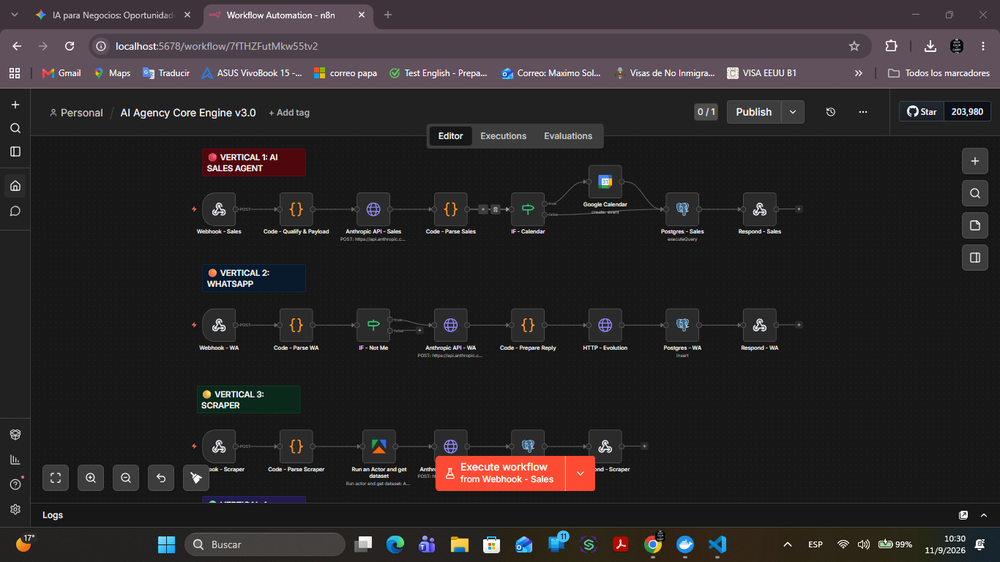
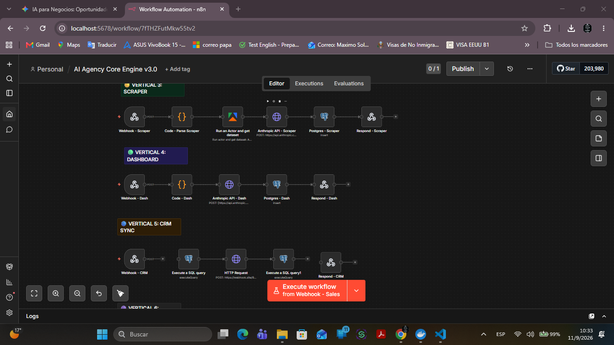
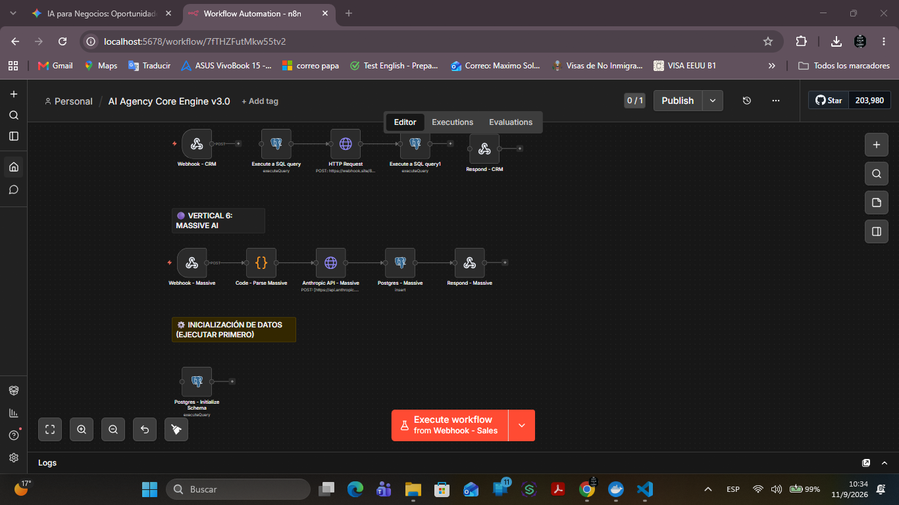

# AI Agency Core Engine v3.0 — Enterprise Automation Architecture

## Executive Overview
Multi-vertical AI-driven orchestration engine designed to automate enterprise sales, WhatsApp communication, web scraping, real-time CRM synchronization, and massive batch AI execution. Engineered for operational efficiency, zero-latency workflows, and deterministic business processing.

## System Architecture

### Verticals 1–3: Core Ingestion & Agent Workflows

### Verticals 4–5: Analytics & CRM Synchronization

### Vertical 6: Massive AI Processing & Schema Initialization

---

## Technical Stack & Infrastructure
* **Orchestration Layer:** n8n (Docker Containerized)
* **LLM Engine:** Anthropic Claude API (Structured JSON Payload Parsing)
* **Data Persistence:** PostgreSQL (Transactional logging & Schema state management)
* **Channel Integrations:** WhatsApp API (Evolution API), Webhooks, Google Calendar API, REST Endpoints

---

## Core System Verticals
1. **Vertical 1: AI Sales Agent:** Ingests incoming lead webhooks, executes Anthropic API qualification, dynamically checks Google Calendar availability, logs interaction state to PostgreSQL, and outputs response payloads.
2. **Vertical 2: WhatsApp Integration:** Processes real-time incoming WhatsApp messages via webhooks, filters internal triggers, routes queries through Anthropic API, and handles delivery via Evolution API.
3. **Vertical 3: Automated Web Scraper:** Triggers web data extraction actors, processes raw dataset payloads, and structures extracted intelligence using Claude.
4. **Vertical 4 & 5: Executive Dashboard & CRM Synchronization:** Handles structured HTTP requests and SQL queries to perform continuous dynamic CRM schema synchronization and real-time dashboard updates.
5. **Vertical 6: Massive AI Processing:** Executes bulk data initialization, schema population, and automated data enrichment at scale.

---
## Intellectual Property Notice
This architecture, system workflow design, and associated documentation are the intellectual property of **Ing. Gian Pierre Solórzano Revilla**. 

This repository contains system architecture documentation, execution schemas, and structural diagrams for professional demonstration, auditing, and portfolio evaluation purposes. Production source workflows, deployment JSON files, private API endpoints, and database connection strings are strictly proprietary and withheld.
